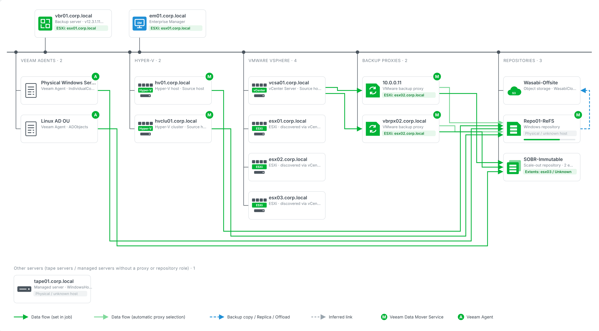
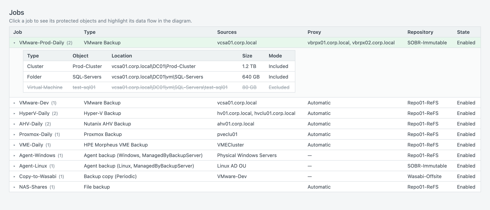

# VBR Topology Scanner

**Author:** Ron Tsai @Veeam Taiwan

> [!IMPORTANT]
> **Both collectors are read-only. They never change anything on VBR.**
>
> - PowerShell: only `Get-*` / `Find-*` cmdlets are called, plus read-only methods of the objects they
>   return (such as `GetProxy()` and `GetPhysicalHost()`). With `-UsePowerCLI`, vCenter is only read
>   (`Get-VM`).
> - Python: only REST `GET` requests, plus login / logout and the inventory browser query
>   (a `POST` that only reads data). With `--vcenter-user`, vCenter is only read (hosts, VMs, guest identity).



*Diagram of a report generated from mock data (`test/`) with the PowerShell collector and the PowerCLI
mock. All names are made up.*

> [!TIP]
> **Try the report without a VBR server:**
> [**open the example report online**](https://htmlpreview.github.io/?https://raw.githubusercontent.com/RonTsai/veeam-util/main/vbr-topology/docs/example.html),
> or download [`docs/example.html`](docs/example.html) (on GitHub, open it and click **Download raw
> file**) and open it in a browser. It is the full report built from the same mock data: hover the
> cards, click a job, switch between English and 中文, export SVG / PNG.

Scans a Veeam Backup & Replication (VBR) server and writes an interactive HTML report, "Backup
infrastructure topology". Its diagram follows the style of the "Backup architecture: data movers" slide:

- the management network with the backup server, Enterprise Manager and Veeam ONE on top
- sources (Veeam Agents, Hyper-V, VMware vSphere, plug-in platforms such as Proxmox VE, Nutanix AHV and
  HPE Morpheus VME), backup proxies and repositories as columns
- vCenter and ESXi versions (product, version, build)
- data-flow arrows derived from the job settings
- the Veeam Data Mover Service (**M**) and Veeam Agent (**A**) badges
- **which ESXi / Hyper-V host each component runs on**

Below the diagram, the report lists the component hosts, the jobs and the full infrastructure inventory.
**Click a job** to list its protected objects (VMs, containers, protection groups, shares, exclusions)
and highlight its data flow in the diagram. See [Jobs and protected objects](#jobs-and-protected-objects).

There are two collectors that produce the same diagram from one shared `template.html`:

| | PowerShell (`Get-VBRTopology.ps1`) | Python (`vbr_topology.py`) |
|---|---|---|
| Runs on | The VBR server (or a machine with the VBR Console) | Any machine that can reach VBR on port 9419 |
| Talks to | Veeam PowerShell module | VBR REST API |
| Needs | Windows PowerShell 5.1 or PowerShell 7 | Python 3.8+, standard library only |
| Enterprise Manager | Auto-detected | `--em <host>` (or auto, when EM is installed on the VBR host) |
| vSphere versions | vCenter and ESXi | vCenter only (with `--vcenter-user`) |
| Plug-in platforms (Proxmox VE, Nutanix AHV, HPE Morpheus VME) | Hosts and jobs | — (not in the REST API) |
| Job protected objects | All job types, with full inventory paths | All but plug-in jobs; location is the host name |
| Extras | Tape servers, replica jobs, SOBR capacity-tier offload | — |

## Files

| File | Purpose |
|---|---|
| `Get-VBRTopology.ps1` | PowerShell collector |
| `vbr_topology.py` | Python / REST collector |
| `template.html` | Diagram template used by both. **Keep it in the same folder as the scripts.** |
| `placement_sample.csv` | Example of a manual component → host map |
| `sample_raw.json` | Demo data for the Python version (`--from-raw sample_raw.json`) |
| `docs/example.html` | Example report built from the mock data, to try without a VBR server |
| `test/` | Offline mocks of the Veeam cmdlets and of the VBR / EM REST APIs |

## Output

Each run writes to its own subfolder, so earlier results are kept:

```
out\
  vbr01_20261028-093012\topology.html
  vbr01_20261028-141530\topology.html
```

| File | Contents |
|---|---|
| `topology.html` | Interactive report. Hovering a card shows its details and highlights related links and hosts; clicking a job lists its protected objects. Exports the diagram as SVG / PNG, and the model as JSON. |
| `topology.json` | Normalized nodes, links and jobs, including each job's protected objects |
| `vbr_raw.json` | Python only: raw API responses, for troubleshooting or re-rendering offline |

### Report language

The report can be switched between Traditional Chinese and English with the **中文 / English** button in
its toolbar. The language it opens in is decided in this order:

1. `?lang=en` or `?lang=zh` in the URL
2. the viewer's last choice (remembered by the browser)
3. `-Language` / `--lang` given when the report was generated (default `zh-TW`)

Veeam product terms (backup proxy, repository, SOBR, job types, ...) stay in English in both languages.
Console output is always English.

How it works: the collectors write English into `topology.json`. `template.html` holds all UI strings
(`I18N`) plus a table that translates the collectors' text (`DATA_ZH`, `DATA_ZH_RULES`). To change a
wording, or add a language, edit only `template.html`.

Use `-NoTimestamp` (PowerShell) or `--no-timestamp` (Python) to write straight into the output folder
instead, for example from a scheduled task.

---

## PowerShell version

### Before you start: install VMware PowerCLI (recommended)

Install VMware PowerCLI on the VBR server **before the first run**. With PowerCLI (`-UsePowerCLI`), the
script matches each component to its ESXi host by guest hostname and IP address. That is the most accurate
method, and it is the only one that finds proxies registered by IP or VMs whose name differs from their
hostname. Without PowerCLI, the script still runs, but falls back to matching on VM names.

```powershell
# Run in PowerShell as administrator, on a VBR server with internet access

# Windows PowerShell 5.1 only: enable TLS 1.2 and the NuGet provider for the PowerShell Gallery
[Net.ServicePointManager]::SecurityProtocol = [Net.SecurityProtocolType]::Tls12
Install-PackageProvider -Name NuGet -MinimumVersion 2.8.5.201 -Force

# Install PowerCLI (pick one)
Install-Module VCF.PowerCLI -Scope AllUsers -AllowClobber      # PowerCLI 9.x (Broadcom)
Install-Module VMware.PowerCLI -Scope AllUsers -AllowClobber   # PowerCLI 13.x

# Check that it is installed
Get-Module -ListAvailable VMware.VimAutomation.Core
```

If the VBR server has no internet access, download PowerCLI on another machine and copy it over:

```powershell
# On a machine with internet access
Save-Module VCF.PowerCLI -Path D:\pcli

# Copy everything under D:\pcli to the VBR server, into
#   C:\Program Files\WindowsPowerShell\Modules
# then check it on the VBR server:
Get-Module -ListAvailable VMware.VimAutomation.Core
```

If a vCenter rejects the login, the script asks once more for that vCenter's credentials, since
vCenters often use different accounts. For unattended runs, use `-VCenterCredentialMap` instead.

You don't need to configure PowerCLI yourself. For the duration of the run, the script ignores vCenter's
self-signed certificate and turns off the CEIP prompt.

### Run

```powershell
# Copy Get-VBRTopology.ps1 and template.html to the VBR server, then, as a VBR administrator:
Set-ExecutionPolicy -Scope Process Bypass
.\Get-VBRTopology.ps1

.\Get-VBRTopology.ps1 -OutDir C:\Temp\vbr-topology
.\Get-VBRTopology.ps1 -EnterpriseManager em01.corp.local        # add an EM manually
.\Get-VBRTopology.ps1 -UsePowerCLI                                 # prompts for the vCenter login
.\Get-VBRTopology.ps1 -UsePowerCLI -VCenterUser readonly@vsphere.local
.\Get-VBRTopology.ps1 -PlacementCsv .\placement.csv
.\Get-VBRTopology.ps1 -Server vbr02.corp.local -Credential (Get-Credential)   # remote VBR
```

| Parameter | Description |
|---|---|
| `-Server` | VBR server to connect to (default `localhost`) |
| `-Credential` | Credentials for `-Server` |
| `-OutDir` | Base output folder (default `.\out`) |
| `-NoTimestamp` | Overwrite `-OutDir` instead of creating a per-run subfolder |
| `-EnterpriseManager` | Enterprise Manager host(s) to add when auto-detection finds nothing |
| `-PlacementCsv` | Manual component → host map (columns `Component,Host[,VM]`) |
| `-UsePowerCLI` | Use VMware PowerCLI to find each component's ESXi host |
| `-VCenterUser` | vCenter user name for `-UsePowerCLI`; the script then asks only for the password |
| `-VCenterCredential` | vCenter credentials as a `PSCredential` (skips the prompt), e.g. for scheduled runs |
| `-VCenterCredentialMap` | Per-vCenter credentials, e.g. `@{ "vc01.corp.local" = $cred1; "vc02.corp.local" = $cred2 }` |
| `-Language` | Default report language: `zh-TW` (default) or `en` |
| `-Template` | Path to `template.html` (default: next to the script) |

Cmdlets used (Get-* / Find-* only):
`Get-VBRServer`, `Get-VBRViProxy`, `Get-VBRHvProxy`, `Get-VBRNASProxyServer`, `Get-VBRWANAccelerator`,
`Get-VBRBackupRepository [-ScaleOut]`, `Get-VBRObjectStorageRepository`, `Get-VBRTapeServer`,
`Get-VBRProtectionGroup`, `Get-VBRDiscoveredComputer`, `Get-VBRJob`, `Get-VBRJobObject`,
`Get-VBRComputerBackupJob`, `Get-VBRBackupCopyJob`, `Get-VBRUnstructuredBackupJob` (`Get-VBRNASBackupJob` on
older versions), `Find-VBRViEntity`, `Find-VBRHvEntity`.

A cmdlet that is missing in your version, or whose feature is not licensed, is skipped and listed as a
warning at the top of the report.

### vSphere versions and plug-in platforms

- vCenter and ESXi versions come from `Get-VBRServer` (`Info.Info`, for example
  `VMware ESXi 8.0.3 build-25595708`); PowerCLI is not needed. When the ESXi hosts run different
  versions, the report shows a warning.
- Plug-in platforms (Proxmox VE, Nutanix AHV, HPE Morpheus VME) are managed servers of type
  `ExternalInfrastructureServer`. The platform is read from the platform ID at the end of
  `GetPhysicalHost().Name`; an unknown ID shows as "Plug-in platform".
- The proxies (workers) of plug-in platforms are not exposed through PowerShell or the REST API, so
  they are not shown. Plug-in jobs link the source host straight to the repository; when the job's
  source is not a registered host (for example a Proxmox cluster name), every host of that platform
  gets an inferred (dashed) link.

### Enterprise Manager / Veeam ONE

There is no official cmdlet that returns the Enterprise Manager a VBR is registered to, so the script uses:

1. `[Veeam.Backup.Core.SBackupOptions]::GetEnterpriseServerInfo()`: the EM registration stored on the VBR.
   This is an undocumented internal API (community tools such as AsBuiltReport use it too) and may change
   between versions.
2. A local service check: EM or Veeam ONE installed on the VBR server itself.
3. `-EnterpriseManager <host>`: manual fallback.

---

## Python version

```bash
# Prompts for the password. --insecure because VBR uses a self-signed certificate by default.
python3 vbr_topology.py --host vbr01.corp.local --user 'CORP\veeam-admin' --insecure --em em01.corp.local

# Find each component's ESXi host by querying vCenter directly (recommended, most accurate)
python3 vbr_topology.py --host vbr01.corp.local --user 'CORP\veeam-admin' --insecure --vcenter-user 'readonly@vsphere.local'

# Password from an environment variable
VBR_PASSWORD='***' python3 vbr_topology.py --host 10.0.0.10 --user admin --insecure

# Offline: re-render an earlier scan, or try the demo data
python3 vbr_topology.py --from-raw out/vbr01_20261028-093012/vbr_raw.json
python3 vbr_topology.py --from-raw sample_raw.json --out demo_out
```

| Option | Description |
|---|---|
| `--host`, `--port` | VBR server and REST port (default 9419) |
| `--user`, `--password` | VBR credentials (or `VBR_PASSWORD`, or the prompt) |
| `--insecure`, `--ca-bundle` | Skip TLS verification / use a custom CA bundle |
| `--api-version` | `x-api-version`, detected automatically by default (1.3 → 1.0) |
| `--em HOST` | Enterprise Manager host, repeatable. Also works with `--from-raw`. |
| `--em-user`, `--em-password` | EM credentials if different from VBR (or `EM_PASSWORD`) |
| `--vcenter-user` | Query vCenter directly for component hosts. A read-only vCenter account is enough. |
| `--vcenter-password` | vCenter password (or `VCENTER_PASSWORD`, or the prompt) |
| `--vcenter HOST` | vCenter address(es) to query, repeatable; default: the vCenters registered in VBR. If one rejects the login, the script asks for that vCenter's user and password (in a terminal only). |
| `--placement-csv` | Manual component → host map |
| `--from-raw` | Render from a saved `vbr_raw.json` instead of connecting |
| `--lang` | Default report language: `zh-TW` (default) or `en` |
| `--out`, `--no-timestamp` | Output folder / overwrite instead of a per-run subfolder |

REST endpoints used:

| Item | Endpoint |
|---|---|
| Backup server | `GET /api/v1/serverInfo` |
| Managed servers (vCenter, ESXi, Hyper-V, Windows, Linux) | `GET /api/v1/backupInfrastructure/managedServers` |
| Proxies, WAN accelerators | `GET /api/v1/backupInfrastructure/proxies`, `/wanAccelerators` |
| Repositories, capacity, SOBR | `GET /api/v1/backupInfrastructure/repositories`, `/repositories/states`, `/scaleOutRepositories` |
| Agent protection groups | `GET /api/v1/agents/protectionGroups` |
| Jobs and backups | `GET /api/v1/jobs`, `/api/v1/jobs/{id}`, `/api/v1/backups` |
| vSphere inventory (placement) | `GET /api/v1/inventory/vmware/hosts/{vCenter}` (legacy), falling back to `POST /api/v1/inventory/{vCenter}` |

vCenter REST API, with `--vcenter-user` (vCenter 7.0 U2+ via `/api`; older vCenters via `/rest`):

| Item | Endpoint |
|---|---|
| Login / logout | `POST` / `DELETE /api/session` |
| ESXi hosts | `GET /api/vcenter/host` |
| VMs per host | `GET /api/vcenter/vm?hosts={host}` |
| Guest hostname / IPs (powered-on VMs with VMware Tools) | `GET /api/vcenter/vm/{vm}/guest/identity`, `/guest/networking/interfaces` |
| vCenter version | `GET /api/appliance/system/version` |

The machine running the script must reach vCenter on port 443. The VBR REST API only lists the vCenter
itself, not its ESXi hosts, so **without `--vcenter-user` the Python report shows no ESXi hosts** and can
only match components by VM name, if at all.

The Python version shows the vCenter version (with `--vcenter-user`), but not ESXi versions or plug-in
platforms (Proxmox VE, Nutanix AHV, HPE Morpheus VME): the VBR REST API does not return them. Use the
PowerShell version for those.

### Enterprise Manager

The VBR REST API does not expose the Enterprise Manager registration, so with Python:

- pass the EM with `--em <host>`. The script then logs in to the EM REST API (port 9398) and checks that this
  VBR is in its list of registered backup servers (`GET /api/backupServers`). If the login fails, the EM is
  still drawn, and the error is shown in its details.
- an EM installed on the VBR server itself is found automatically (port 9398 open on the VBR host).

---

## Which host each component runs on

Every component card (backup server, EM, proxies, repositories, tape and other servers) shows its host, for
example `ESXi: esx01.corp.local`. Anything not found shows as "Physical / unknown host". SOBR
cards summarize where their extents run. Hovering an ESXi host highlights every component on it.
The report also has a table grouped by host.

Hovering a card also shows its **IP address**: the VM's guest IPs when PowerCLI (`-UsePowerCLI`) or the
vCenter REST API (`--vcenter-user`) matched it ("VM guest"), otherwise what DNS returns for its name on
the machine that builds the report ("DNS"). IPv4 addresses are preferred; loopback and link-local
addresses are left out.

Matching methods, highest priority first:

| Method | PowerShell | Python | Notes |
|---|---|---|---|
| Manual CSV | `-PlacementCsv` | `--placement-csv` | Columns `Component,Host,VM`. See `placement_sample.csv`. |
| vCenter, guest hostname / IP | `-UsePowerCLI` | `--vcenter-user` | Matches the guest hostname and IP addresses. **Most accurate.** |
| Veeam inventory (default) | `Find-VBRViEntity` / `Find-VBRHvEntity` | inventory REST API | Matches the VM name. |

With the Veeam inventory, the VM name must match the component's hostname (FQDN or short name). Names that
are IP addresses are first resolved through DNS. Components that are still not found are usually physical
servers, or VMs whose name differs from their hostname. Add those with the CSV, or use PowerCLI
(PowerShell) / `--vcenter-user` (Python).

To install PowerCLI, see [Before you start: install VMware PowerCLI](#before-you-start-install-vmware-powercli-recommended).
Without PowerCLI, the script falls back to the Veeam inventory automatically.

---

## How the data flow is worked out

- **VMware job**: source vCenter / ESXi → the job's proxies → target repository. With automatic proxy selection,
  every VMware proxy is linked (light green).
- **Hyper-V job**: on-host mode links the Hyper-V host straight to the repository, because the host runs the
  Data Mover itself. Off-host mode goes through the proxy.
- **Plug-in job** (Proxmox VE, Nutanix AHV, HPE Morpheus VME, PowerShell only): source host → repository,
  since the plug-in proxies cannot be read. When the job's source is not a registered host (for example a
  Proxmox cluster name), every host of that platform gets an inferred (dashed) link.
- **Agent job**: protection group → repository
- **File share job**: general-purpose proxies → repository
- **Backup copy, replica, SOBR offload**: blue dashed line
- **SOBR extents**: merged into their SOBR
- **Sources without job information**: get a gray dashed "inferred" link to the proxies. ESXi hosts are skipped
  when a vCenter is present.
- **Managed servers without a role**: listed under "Other servers"

## Jobs and protected objects



Click a job in the **Jobs** table to expand its protected objects: type, name, location, size, and
whether the object is included or excluded (excluded rows are struck through). The job's links stay
highlighted in the diagram until you click the job again, even while you hover other cards.

| Job type | PowerShell | Python (REST) |
|---|---|---|
| VMware, Hyper-V, Cloud Director, replica | `Get-VBRJobObject` (type from `TypeDisplayName`, full inventory path) | `virtualMachines.includes` / `excludes.vms` (location is the host name) |
| Plug-in (Proxmox VE, Nutanix AHV, HPE Morpheus VME) | `Get-VBRJobObject` (no location) | — (not in the REST API) |
| Agent | `BackupObject`: protection groups | `computers`: protection groups |
| File share, object storage | `BackupObject`: shares and buckets, then their include / exclude File masks (and tag masks for buckets) | `objects`: the same |
| Backup copy | Source jobs and repositories | `sourceObjects` |

The **Include / Exclude** column matches the VBR job settings: for VM jobs, an excluded object is on the
job's **Exclusions** list; for file share jobs, the **File masks** (include and exclude) are listed as
`File mask` rows. Disk-level settings (which disks of a VM to process) are not shown as exclusions.

## Offline tests

```powershell
# PowerShell: fake Veeam cmdlets (also runs with pwsh 7 on macOS / Linux)
. .\test\Mock-VeeamCmdlets.ps1; .\Get-VBRTopology.ps1 -Server vbr01.corp.local -OutDir .\test\out_ps -NoTimestamp

# With fake PowerCLI as well (the vCenter password "bad" is rejected)
. .\test\Mock-PowerCLI.ps1; .\Get-VBRTopology.ps1 -Server vbr01.corp.local -OutDir .\test\out_ps -NoTimestamp -UsePowerCLI
```

Use a new PowerShell window afterwards: the fake cmdlets stay loaded and hide the real Veeam ones until
the window is closed.

```bash
# Python: offline, from the demo data
python3 vbr_topology.py --from-raw sample_raw.json --out demo_out --no-timestamp

# Python: HTTPS mock of the VBR, EM and vCenter REST APIs (needs a self-signed cert)
openssl req -x509 -newkey rsa:2048 -nodes -keyout key.pem -out cert.pem -days 2 -subj /CN=localhost
python3 test/mock_vbr_rest.py cert.pem key.pem 19419 19398 19443 &   # VBR, EM and vCenter mocks
EM_REST_PORT=19398 VBR_PASSWORD=x VCENTER_PASSWORD=x python3 vbr_topology.py --host localhost --port 19419 \
  --user admin --insecure --em localhost --vcenter-user ro@vsphere.local --vcenter localhost:19443
```

## Known limitations

See "Known limitations" in [CHANGELOG.md](CHANGELOG.md).
